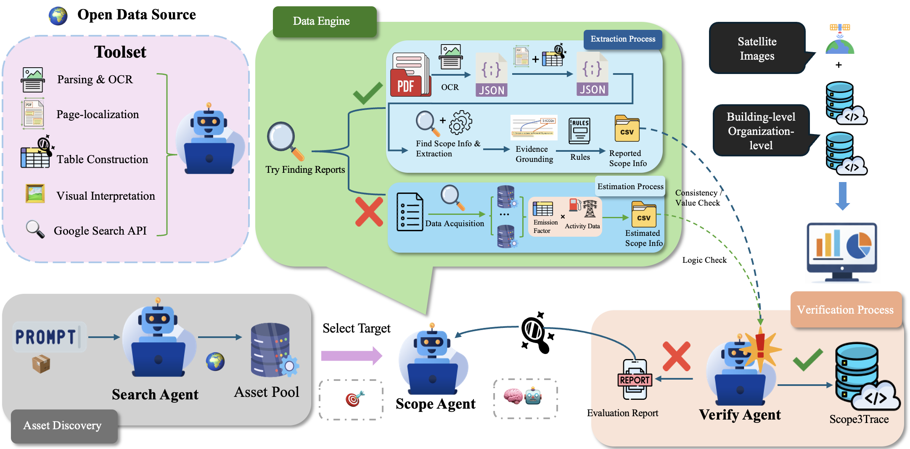

# Scope3Trace: Evidence-Based Identification and Extraction of Scope 3 GHG Emissions from Sustainability Reports (EMNLP 2026 Findings)

Official code for the paper:

**Scope3Trace: Evidence-Based Identification and Extraction of Scope 3 GHG Emissions from Sustainability Reports**

## Abstract

Scope 3 greenhouse gas (GHG) emissions account for the majority of corporate carbon footprints, yet remain difficult to analyze at scale due to sparse disclosures, heterogeneous report document formats, and limited evidence traceability. Existing approaches typically rely on large language models to extract emissions information from ESG reports, but often lack explicit evidence grounding or depend on costly manual annotation and verification to ensure extraction reliability. To address these challenges, we propose Scope3Trace, an evidence-grounded information extraction framework designed to extract interpretable and traceable Scope 3 emissions information from real-world ESG and sustainability reports. The framework integrates a document information extraction pipeline that performs PDF collection and OCR parsing, LLM-assisted page localization and table reconstruction, and hybrid rule–LLM extraction of organization- and building-level emissions disclosures with evidence-grounded verification. Building upon this framework, we further contribute a dual-level, evidence-grounded, multimodal dataset comprising organization-level Scope 3 disclosures extracted from heterogeneous sustainability reports. Scope3Trace enables reliable extraction and transparent integration of heterogeneous sustainability disclosures, achieving high accuracy in extracting Scope 1–3 totals and category-level disclosures from sustainability reports.

<p align="center">
  
</p>

**Figure 1.** Overview of the Scope3Trace multi-agent system (Figure 2 of the paper). The pipeline is composed of three specialized agents, the Search Agent, Scope Agent, and Verify Agent, which perform data acquisition, parsing, extraction, and verification. By combining structured parsing (e.g., page localization and table reconstruction) with explicit evidence grounding, the system ensures that all extracted values are traceable and reliable.

## Results

Extraction performance on the gold evaluation set, mean ± standard deviation over 3 runs (selected rows of Table 1 of the paper; the paper also reports chunked per-page LLMs, three model families and the multi-agent baselines in full).

<div align="center">

| Method                              | Scope 1 F1     | Scope 2 F1     | Scope 3 F1     | Category F1    | EM            |
|:---|:---:|:---:|:---:|:---:|:---:|
| Rule-only                           | 0.86±0.00      | 0.86±0.00      | 0.86±0.00      | 0.51±0.01      | 0.45±0.01     |
| Single-call LLM (GPT-4o, native PDF)| 0.87±0.02      | 0.86±0.02      | 0.87±0.02      | 0.79±0.03      | 0.72±0.03     |
| (Beck et al., 2025)-style           | 0.88±0.02      | 0.87±0.02      | 0.88±0.02      | 0.78±0.03      | 0.71±0.03     |
| MetaGPT-style                       | 0.86±0.03      | 0.85±0.03      | 0.86±0.03      | 0.77±0.04      | 0.59±0.04     |
| w/o page localization               | 0.95±0.01      | 0.94±0.01      | 0.95±0.01      | 0.93±0.02      | 0.88±0.02     |
| w/o table reconstruction            | 0.89±0.02      | 0.88±0.02      | 0.89±0.02      | 0.82±0.03      | 0.75±0.03     |
| w/o evidence grounding              | 0.90±0.02      | 0.89±0.02      | 0.88±0.02      | 0.84±0.03      | 0.78±0.02     |
| **Scope3Trace (GPT-4o)**            | **0.99±0.004** | **0.98±0.006** | **0.99±0.004** | **0.97±0.008** | **0.96±0.01** |

</div>

## Repository layout

```
scope3trace/
  run_scope3trace.py        end-to-end pipeline: Search -> Scope -> Verify
  common/                   shared state, LLM client, prompts, rules
    config.py               model -> endpoint routing, prices, constants
    llm.py                  bounded temperature-0 chat-completions client with token / cost metering
    prompts.py              prompts of the bounded LLM tasks
    rules.py                numbers, units, years, Scope 3 category mapping
    perimeter.py            reporting-perimeter selection
    state.py                typed shared state and the v2.1 record export
  search_agent/             paper §3.3.2 stages 1-2
    agent.py                acquisition, PDF-to-text parsing / OCR, page and sentence localization
    report_search.py        web search, download and identity check of report PDFs
    pdf_source.py           visible-page geometry
    font_repair.py          recovers digits and separators that a font maps to U+FFFD
  scope_agent/              paper §3.3.2 stages 3-4
    agent.py                disclosure extraction
    table_structure.py      table structure reconstruction and cell binding
    source_context.py       captions, footnotes and table continuations across pages
    text_binding.py         values stated in prose
    chart_reader.py         charts and image tables, read by a vision model
  verify_agent/
    agent.py                evidence checks, semantic validation, consistency and logic checks
    feedback.py             bounded Verify -> Search / Scope repair rounds
  evaluation/
    table1_eval.py          Table 1 scoring (exact normalized values)
    run_table1_experiment.py  repeated runs and component ablations
    score_predictions.py    tolerance-based scorer
```

The agents run in a fixed order over one shared state; there is no free-form conversation between them (Appendix F of the paper shows that free-form orchestration overwrites correct values). The LLM is restricted to bounded semantic tasks (page localization, table interpretation, relevance validation), while numeric parsing, unit normalization, category mapping and evidence checks are rule-based.

### Figure 1 components in the code

<div align="center">

| Figure 1                                   | Agent  | Code |
|:---|:---:|:---|
| Google Search API, Try Finding Reports     | Search | `search_agent/report_search.py`, `SearchAgent.acquire_from_search` |
| Parsing & OCR                              | Search | `SearchAgent.parse_pdf`, `search_agent/font_repair.py` |
| Page-localization                          | Search | `SearchAgent._localize`, `SearchAgent._localize_sentences` |
| Table Construction                         | Scope  | `scope_agent/table_structure.py`, `scope_agent/source_context.py` |
| Find Scope Info & Extraction               | Scope  | `ScopeAgent.extract_disclosures` |
| Visual Interpretation                      | Scope  | `scope_agent/chart_reader.py` |
| Evidence Grounding, Rules                  | Scope  | `bind_value` in `table_structure.py`, `scope_agent/text_binding.py`, `common/rules.py` |
| Consistency / Value Check, Logic Check     | Verify | `verify_agent/agent.py` |
| Evaluation Report                          | Verify | `VerifyAgent.build_evaluation_report`, `verify_agent/feedback.py` |

</div>

Table reconstruction runs during the Search Agent's parsing, in the same pdfplumber page-layout pass that checks the visible page text; its output is attached to the Search Agent's verbatim evidence list and interpreted only by the Scope Agent.

## Requirements

Python 3.10 or newer. Run all commands from the repository root.

```bash
pip install -r requirements.txt
```

`requirements.txt` pins the versions the code was developed and tested with:

```
pypdf==6.21.2
pdfplumber==0.11.10
pdfminer.six==20260107
pypdfium2==5.14.0
requests==2.34.2
pandas==2.3.3
pytesseract==0.3.13
pillow==12.3.0
```

OCR of scanned pages and chart images also needs the `tesseract` (4.1 or newer) and `poppler` (`pdftoppm`) binaries, for example `brew install tesseract poppler` on macOS or `apt install tesseract-ocr poppler-utils` on Debian / Ubuntu. Without them only the PDF text layer is used. `python-dotenv` is optional; without it a built-in reader loads `.env`.

## Data

The Scope3Trace dataset has two linked levels (Section 3.2 of the paper). Organization-level records hold one organization and reporting year: Scope 1 and 2 totals, the Scope 3 total and its category breakdown, the reporting boundary, assurance status, and the evidence snippet of every value. Building-level records hold one building and year: physical attributes, geospatial coordinates, operational activity indicators and semantic metadata such as building type, with satellite imagery as supplementary multimodal context.

The dataset, including the organization-level disclosures, the gold evaluation set (Appendix H of the paper) and the source report list, will be released on Hugging Face as soon as possible. The link will be added here.

## Usage

### 1. Configure API keys

Copy `.env.example` to `.env` and fill in the keys you need. Keys are read from `.env` or the environment and are never written to outputs or logs.

<div align="center">

| Variable | Used for |
|:---|:---|
| `OPENAI_API_KEY`, `DEEPSEEK_API_KEY`, `GEMINI_API_KEY` | Backbone of the three agents (`--model`, default `gpt-4o`; e.g. `deepseek-chat`, `gemini-2.0-flash`) |
| `OPENROUTER_API_KEY`, `OPENROUTER_API_URL` | Report search (default backend) and vendor-prefixed model ids such as `google/gemini-2.5-flash` |
| `SCOPE3TRACE_SEARCH_MODEL`, `SCOPE3TRACE_SEARCH_ENGINE` | Model and engine of the web search (default `openai/gpt-4o-mini`, `exa`) |
| `GOOGLE_API_KEY`, `GOOGLE_CSE_ID` | Optional search backend: Google Custom Search JSON API (`--search-backend google`) |
| `SCOPE3TRACE_CHART_MODEL` | Vision model of the chart reader: default `gemini-2.5-flash` through the Gemini API (`GEMINI_API_KEY`); `google/gemini-2.5-flash` runs the same model through OpenRouter (`OPENROUTER_API_KEY`). `SCOPE3TRACE_CHART_READER=0` disables the chart reader |

</div>

**Which model runs where.** `--model` sets the backbone of the Search, Scope and Verify Agents, and `--search-model`, `--scope-model` and `--verify-model` override it per agent (`--search-model` is the Search Agent's backbone for page localization, not the report-search model). The chart reader and the report search have their own models (`SCOPE3TRACE_CHART_MODEL`, `SCOPE3TRACE_SEARCH_MODEL`), so `--model gpt-4o` does not change them. If an agent's backbone has no API key, that agent runs with rule-based fallbacks and a warning is printed; add `--strict-llm` to stop instead (runs with `--gold-dir` are strict by default). Without a key for the chart model the chart reader is off, and values printed only in charts or images are not read.

### 2. Run the pipeline

From an organization name: the Search Agent finds, downloads and checks the report, and the Scope and Verify Agents extract and verify its disclosures.

```bash
python -m scope3trace.run_scope3trace --search-org "Heineken N.V." --report-year 2025 \
    --model deepseek-chat -o out/heineken_2025
```

From local PDFs or a manifest (a CSV with a `local_path` column):

```bash
python -m scope3trace.run_scope3trace --pdf report.pdf --org-name "Acme" --report-year 2024 -o out/acme
python -m scope3trace.run_scope3trace --pdf-dir reports/ --model deepseek-chat -o out/run
python -m scope3trace.run_scope3trace --manifest manifest.csv -o out/run
```

- `--rule-only` turns off every LLM call of the three agents (the Rule-only baseline of Table 1); report search with `--search-org` still uses its search backend.
- `--search-model`, `--scope-model` and `--verify-model` give each agent its own backbone (Appendix E).
- `--max-repair-rounds N` enables up to N Verify-driven repair rounds.
- `--no-page-localization`, `--no-table-reconstruction` and `--no-evidence-grounding` are the ablations of Table 1.

### 3. Building-level inventory (optional)

With a building inventory, the Scope Agent links the buildings named in a report to the inventory and adds building-level values (Appendix C):

```bash
python -m scope3trace.run_scope3trace --pdf report.pdf --model deepseek-chat \
    --inventory-csv buildings_v2.1.csv --entity-csv entity_aliases.csv \
    --grid-factor-csv grid_factors.csv -o out/buildings
```

- `--inventory-csv`: one row per `property_id` and `report_year`, with optional columns such as `building_name`, `address`, `state`, `primary_usage`, `floor_area_sqm`, `energy_electricity_kwh` and reported `scope1_tco2e_value` / `scope2_location_based_tco2e_value`.
- `--entity-csv` (optional): facility aliases with `facility_name` and `responsible_entity` or `building_owner`.
- `--grid-factor-csv` (optional): `region` or `state`, `report_year` and `factor_t_per_kwh`.

Reported values are never overwritten and estimates only fill gaps. `derived_components.csv` keeps only values backed by verified report evidence or estimates the Verify Agent marks applicable; everything else is listed in `derived_components_audit.csv`.

## Outputs

Each run writes to the folder given by `-o`:

<div align="center">

| File | Content |
|:---|:---|
| `organization_disclosures.jsonl` | One v2.1 record per report and reporting year (several reports of one organization and year give several records); verified values only |
| `organization_disclosures_evidence.jsonl` | Every candidate value with its page, source snippet, table cell binding and verification note |
| `evaluation_report.md`, `evaluation_report.json` | Verify Agent diagnostics, consistency checks and per-agent tokens, time and cost |
| `parsed_pages.jsonl` | Parsed page text and reconstructed tables |
| `state.json` | Full shared state, including the phase log |
| `repair_history.json`, `unresolved_issues.json` | Repair rounds and the issues left open |
| `derived_components.csv`, `derived_components_audit.csv` | With `--inventory-csv`: the accepted building-level components, and every candidate component with its validation status and note |
| `search_manifest.csv`, `downloads/` | With `--search-org`: the accepted report PDFs |

</div>

Every value extracted from a report is traceable: its evidence entry names the page, the source text or table cell, the year and unit as printed, and how it was verified. Building-level estimates are traced to their inventory inputs, formula and emission factor instead. Values read from charts or image tables are marked `binding.origin = "chart_vision"`; they rank below table and text values and only fill fields that no table or text states.

## Citation

```bibtex
@inproceedings{zheng2026scope3trace,
  author    = {Zheng, Siyuan and Duan, Yifan and Xue, Chao and Salim, Flora D.},
  title     = {Scope3Trace: Evidence-Based Identification and Extraction of Scope 3 GHG Emissions from Sustainability Reports},
  booktitle = {Findings of the Association for Computational Linguistics: EMNLP 2026},
  month     = oct,
  year      = {2026},
  address   = {Budapest, Hungary},
  publisher = {Association for Computational Linguistics},
  eprint    = {2607.17122},
  archivePrefix = {arXiv},
  url       = {https://arxiv.org/abs/2607.17122}
}
```

## Acknowledgments

This research is supported by the ARC Training Centre for Whole Life Design of Carbon Neutral Infrastructure (IC230100015).

## License

Released under the license in [LICENSE](LICENSE). The LLaMA components keep
their original license terms.